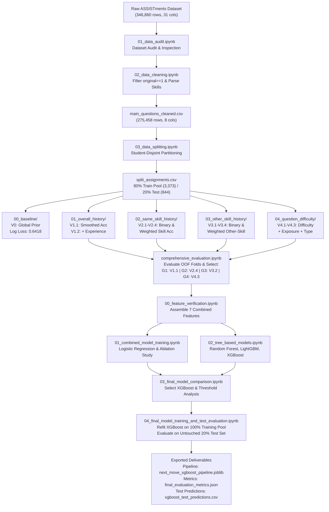

# Next Move AI — Predicting Student Performance Through Learning Interaction History

**Course:** ES 335: Machine Learning  
**Project:** Next Move AI  
**Dataset:** ASSISTments 2009–2010 Skill Builder  
**Primary Task:** Binary Classification (Next-Interaction Outcome Prediction)  
**Primary Deliverable:** Interaction-level probability estimation & risk-of-failure classification  
**Team Members (Equal 50% / 50% Partnership):**  
- **Rajuri Prathik** (Roll Number: `25110262`)
- **Manikanta Naidu Uppala** (Roll Number: `25110330`)
- **Comprehensive Defense Document:** [CONTRIBUTIONS.md](CONTRIBUTIONS.md)

---

## Table of Contents

- [Team Members & Contribution Breakdown](#team-members--contribution-breakdown)
- [1. Project Overview](#1-project-overview)
- [2. Problem Formulation](#2-problem-formulation)
- [3. Dataset Description & Access](#3-dataset-description-access)
  - [3.1 Source and Access Instructions](#31-source-and-access-instructions)
  - [3.2 Dataset Dimensions & Schema](#32-dataset-dimensions-schema)
  - [3.3 Column Specifications](#33-column-specifications)
  - [3.4 Cleaning Decisions & Column Count Reconciliation](#34-cleaning-decisions-column-count-reconciliation)
- [4. Project Workflow](#4-project-workflow)
- [5. Data Preprocessing & Leakage Prevention](#5-data-preprocessing-leakage-prevention)
- [6. Train/Test Split & Validation Protocol](#6-traintest-split-validation-protocol)
  - [6.1 Student-Level Partitioning](#61-student-level-partitioning)
  - [6.2 Five-Fold Student-Grouped Cross-Validation](#62-five-fold-student-grouped-cross-validation)
- [7. Feature Engineering Architecture](#7-feature-engineering-architecture)
  - [7.1 Feature Information Groups (G1–G4)](#71-feature-information-groups-g1g4)
  - [7.2 Mathematical Smoothing Formulation](#72-mathematical-smoothing-formulation)
  - [7.3 Final Combined Feature Set](#73-final-combined-feature-set)
- [8. Baseline Model (V0)](#8-baseline-model-v0)
- [9. Individual Feature-Group Experiments](#9-individual-feature-group-experiments)
- [10. Combined Model & Feature Group Ablation Study](#10-combined-model-feature-group-ablation-study)
- [11. Advanced Model Comparison (5-Fold Out-of-Fold CV)](#11-advanced-model-comparison-5-fold-out-of-fold-cv)
- [12. Final Model Architecture & Test Evaluation](#12-final-model-architecture-test-evaluation)
- [13. Risk Threshold & Confusion Matrix Analysis](#13-risk-threshold-confusion-matrix-analysis)
- [14. Feature Importance Analysis](#14-feature-importance-analysis)
- [15. Limitations & Future Work](#15-limitations-future-work)
- [16. Environment Setup & Reproducibility Guide](#16-environment-setup-reproducibility-guide)
  - [16.1 Python Environment & Dependencies](#161-python-environment-dependencies)
  - [16.2 Dataset Setup](#162-dataset-setup)
  - [16.3 Notebook Execution Order](#163-notebook-execution-order)
  - [16.4 Loading Pretrained Model Artifacts](#164-loading-pretrained-model-artifacts)
  - [16.5 Known Path Inconsistencies & Execution Notes](#165-known-path-inconsistencies-execution-notes)
- [17. Repository Structure](#17-repository-structure)
- [18. References & Acknowledgements](#18-references-acknowledgements)
- [19. AI-Use Disclosure](#19-ai-use-disclosure)

---

## Team Members & Contribution Breakdown

This project was developed, architected, and validated as an equal partnership (**50% / 50%**) between two team members for **ES 335: Machine Learning**:

| Student Name | Roll Number | Primary Module Ownership & Key Contributions | Effort Share |
|---|:---:|---|:---:|
| **Rajuri Prathik** | `25110262` | Data engineering, temporal leakage prevention framework, Bayesian $m$-estimate smoothing ($\alpha = 10$), student historical features (Groups G1 & G2), reusable `src/` package, and client-side Float32 browser simulator (`website/`). | **50%** |
| **Manikanta Naidu Uppala** | `25110330` | Item difficulty & transfer modeling (Groups G3 & G4), multimodal feature synthesis, systematic feature ablation study, tree-based ensemble modeling (Random Forest, LightGBM, XGBoost), asymmetric operational risk thresholding ($\tau = 0.2880$), and holdout test set evaluation. | **50%** |

> For the comprehensive individual breakdown, technical justifications, limitations, defense reasoning for small parameter/protocol changes, and the 26-notebook responsibility matrix adhering to the project defense rubric, see the dedicated **[CONTRIBUTIONS.md](CONTRIBUTIONS.md)** file.

---

## 1. Project Overview

**Next Move AI** is an educational machine learning project developed for **ES 335: Machine Learning**. The system predicts whether a student's next eligible main-question interaction on an intelligent tutoring platform will be recorded as correct ($1$) or non-correct ($0$), conditioned strictly on the student's chronological learning history and problem attributes.

### Key Scope & Design Principles

- **Prediction Unit:** An individual main-question interaction (an individual student attempting an original question).
- **Task Framing:** Binary classification evaluated via predicted probabilities (evaluating calibration alongside discrimination) and downstream threshold-based risk identification.
- **Potential Applications:** A conceptual use case for this predictive model is identifying upcoming interactions where a student may struggle, which could inform potential educational support such as timely scaffolding hints, prerequisite reviews, or teacher alerts. These pedagogical interventions represent prospective operational applications and were not experimentally implemented or evaluated in this machine-learning study.
- **Academic Scope Disclaimer:** This project predicts interaction-level outcomes ($P(\text{correct})$). It does **not** estimate overall student intelligence, grade-point average, or cumulative cognitive mastery. Predictive relationships observed in observational log data do not establish causal pedagogical mechanisms.

---

## 2. Problem Formulation

Let $s \in \mathcal{S}$ denote a student and let $t$ index the chronological sequence of interactions for student $s$, ordered strictly by the global sequence identifier `order_id`.

For each target interaction at step $t$:
- **Input Features ($\mathbf{x}_{s,t}$):** A feature vector constructed exclusively from information generated strictly prior to interaction $t$ (i.e., interactions with `order_id` strictly smaller than the target `order_id` for student $s$, or prior interactions from other students when estimating question difficulty).
- **Target Label ($y_{s,t} \in \{0, 1\}$):** Recorded binary outcome in column `correct` ($1$ if the interaction outcome was recorded as correct; $0$ if recorded as non-correct).
- **Model Output ($\hat{p}_{s,t}$):** Estimated probability of a correct interaction outcome: $\hat{p}_{s,t} = P(y_{s,t} = 1 \mid \mathbf{x}_{s,t})$.
- **Failure Risk Probability ($r_{s,t}$):** The complementary probability representing the risk of interaction failure: $r_{s,t} = P(y_{s,t} = 0 \mid \mathbf{x}_{s,t}) = 1 - \hat{p}_{s,t}$.

### Interaction-Level vs. Student-Level Distinction

Next Move AI operates at the **interaction level**, not at the aggregate student level. A high-performing student encountering a difficult, unfamiliar skill will exhibit high predicted risk on that specific question, while a struggling student practicing an elementary concept may exhibit low predicted risk.

---

## 3. Dataset Description & Access

### 3.1 Source and Access Instructions

This project utilizes the **ASSISTments 2009–2010 Skill Builder** dataset (specifically the corrected, collapsed edition).

- **Official Source Webpage:** [ASSISTments Data — Skill Builder Data (2009–2010)](https://sites.google.com/site/assistmentsdata/home/2009-2010-assistment-data/skill-builder-data-2009-2010)
- **Direct Webpage URL:** `https://sites.google.com/site/assistmentsdata/home/2009-2010-assistment-data/skill-builder-data-2009-2010`
- **Canonical File Name:** `skill_builder_data_corrected_collapsed.csv`
- **Local Expected Location:** `data/raw/skill_builder_data_corrected_collapsed.csv`

> **Data Hosting Notice:** To comply with academic data distribution terms and repository size limits, neither the raw ASSISTments CSV nor processed intermediate datasets are committed to Git. The entire `data/` directory is excluded via `.gitignore`. Users must download the CSV from the official link above and place it in `data/raw/` prior to running preprocessing notebooks.

### 3.2 Dataset Dimensions & Schema

| Property | Raw Dataset | Processed Main-Question Set |
|---|---:|---:|
| Total Interaction Records | 346,860 | 275,458 |
| Total Columns | 31 | 8 |
| Unique Students (`user_id`) | 4,217 | 4,217 |
| Unique Problems (`problem_id`) | 26,688 | 26,688 |
| Unique Sequence IDs (`order_id`) | 346,860 | 275,458 |
| Correct Records (`correct = 1`) | 228,883 (65.99%) | 181,353 (65.84%) |
| Incorrect Records (`correct = 0`) | 117,977 (34.01%) | 94,105 (34.16%) |

### 3.3 Column Specifications

The cleaned dataset retains 8 specific fields essential for historical modeling:

1. `user_id` (`int64`): Unique student identifier.
2. `order_id` (`int64`): Globally unique sequential transaction identifier establishing chronological order across all platform events.
3. `problem_id` (`int64`): Unique question identifier.
4. `correct` (`int64`): Binary prediction target representing the recorded outcome on the main-question interaction (1 = recorded correct; 0 = recorded non-correct/incorrect).
5. `skill_id` (`object`): Original raw skill identifier (contains single IDs, missing values, or multi-skill strings joined by underscores, e.g., `28_31`).
6. `skill_set` (`object`): Parsed Python set of unique string skill IDs. Missing skill records are represented by empty sets `set()`.
7. `attempt_count` (`int64`): Number of answer submissions on this individual question record. Retained for data auditing only; **strictly excluded as a predictive feature**.
8. `answer_type` (`object`): Categorical question format: `algebra` (227,521), `fill_in_1` (26,979), `choose_1` (20,850), `choose_n` (100), and `open_response` (8).

### 3.4 Cleaning Decisions & Column Count Reconciliation

1. **Exclusion of Scaffolding Questions:** The raw dataset contains 71,402 scaffolding sub-questions (`original == 0`) triggered only after a student fails an initial main question. Scaffolding questions are excluded from the prediction target pool and interaction counters because they reflect remedial system intervention rather than independent problem solving. Retaining only main questions (`original == 1`) yields 275,458 records.
2. **Missing Skill Information:** 16,059 main-question rows (5.83%) lack skill tags (`skill_id` is NaN). These interactions are retained: they contribute to global and overall student historical counts, but do not contribute to skill-specific accumulators.
3. **Repeated Interactions:** Some students encounter the same `problem_id` multiple times. Chronological tracking accounts for this: earlier encounters contribute to history, but the current attempt is predicted without self-leakage.
4. **Column Count Reconciliation:** Early project documentation (`docs/data_cleaning.md`) initially planned a 7-column schema omitting `answer_type`. The cleaning notebook (`notebooks/02_data_cleaning.ipynb`) and the verified CSV on disk (`data/processed/main_questions_cleaned.csv`) explicitly retain all **8 columns** listed above, as `answer_type` was incorporated for Group 4 question modeling.

---

## 4. Project Workflow



---

## 5. Data Preprocessing & Leakage Prevention

Strict measures were implemented to prevent target and temporal data leakage:

1. **Chronological Sorting:** All interactions are sorted by `user_id` and ascending `order_id`.
2. **Past-Only Historical Windows:** For student $s$ at question index $t$, historical counters evaluate only interactions with strictly earlier sequence IDs: $\text{order\_id} < \text{order\_id}_{s,t}$.
3. **Cumulative Outcome Shifting:** Historical correct counts apply a 1-step lag (`cumsum().shift(1, fill_value=0)`). The current target outcome $y_{s,t}$ is never included in its own historical features.
4. **Exclusion of `attempt_count`:** The `attempt_count` column records the total number of submissions made by the student on that specific question interaction. Because this count is determined during or after the question attempt, using the current row's `attempt_count` as a predictor would introduce severe post-target leakage; it is strictly excluded from all feature engineering pipelines.
5. **Question Difficulty Isolation:** When calculating the difficulty of `problem_id` for student $s$, all historical attempts made by student $s$ on that problem are subtracted from the question's cumulative counters. Thus, student $s$'s past success or struggle on that exact question cannot leak into their question difficulty estimate.

---

## 6. Train/Test Split & Validation Protocol

### 6.1 Student-Level Partitioning

Standard random interaction splits cause severe identity leakage in educational datasets, allowing a student's interactions to appear simultaneously in training and test sets. To measure true out-of-sample generalization to new students, all data splitting is performed at the **unique student level** using `random_state = 42`:

| Partition | Proportion | Unique Students | Total Interactions |
|---|---:|---:|---:|
| **Training Pool** | 80% | 3,373 | 219,983 |
| **Held-Out Test Set** | 20% | 844 | 55,475 |
| **Total** | 100% | 4,217 | 275,458 |

Zero student overlap exists between the training pool and the test set:

$$\mathcal{S}_{\text{train}} \cap \mathcal{S}_{\text{test}} = \emptyset$$

### 6.2 Five-Fold Student-Grouped Cross-Validation

The 3,373 training-pool students were split into 5 disjoint validation folds using `KFold(n_splits=5, shuffle=True, random_state=42)`:

| Fold Round | Training Students | Validation Students | Validation Interactions |
|:---:|---:|---:|---:|
| Fold 1 | 2,698 | 675 | 42,659 |
| Fold 2 | 2,698 | 675 | 43,710 |
| Fold 3 | 2,698 | 675 | 49,797 |
| Fold 4 | 2,699 | 674 | 41,672 |
| Fold 5 | 2,699 | 674 | 42,145 |
| **Pooled OOF** | — | **3,373** | **219,983** |

In each fold, all preprocessing statistics, priors, and model weights were derived exclusively from that fold's 4 training groups.

---

## 7. Feature Engineering Architecture

### 7.1 Feature Information Groups (G1–G4)

The feature space isolates four distinct information domains:

- **Group 1 (G1) — Overall Student History:** The student's global track record across all previous eligible main questions, regardless of topic.
- **Group 2 (G2) — Same-Skill History:** The student's track record on questions sharing at least one skill with the target question. Weighted features allocate fractional credit when questions span multiple skills ($w = 1 / |\text{skills}|$).
- **Group 3 (G3) — Other-Skill History:** Performance on previously attempted questions that do *not* overlap with the target question's skills, capturing transferable general ability across unrelated domains.
- **Group 4 (G4) — Question Difficulty & Type:** Question-level empirical success rates calculated across other students prior to the target interaction, along with question exposure counts and categorical problem formats.

### 7.2 Mathematical Smoothing Formulation

Raw empirical proportions suffer from high variance when observation counts are small (the "cold-start" problem). All historical accuracy features apply Bayesian m-estimate smoothing:

$$\text{Smoothed Accuracy} = \frac{C + \alpha \cdot P}{N + \alpha}$$

Where:
- $C$: Number of previous recorded correct answers.
- $N$: Number of previous recorded interactions.
- $P$: Historical global prior estimated strictly from earlier records in the training partition.
- $\alpha$: Smoothing strength parameter, fixed at $\alpha = 10$.

**Intuition:** When a student or question has zero prior interactions ($N = 0$), the smoothed estimate gracefully shrinks to the empirical global prior $P$. As interaction volume grows ($N \gg \alpha$), the estimate converges to the student's true observed success rate $C/N$.

### 7.3 Final Combined Feature Set

Cross-validation experiments selected **7 core features** (6 continuous, 1 categorical) for the final model:

| No. | Feature Name | Group | Type | Description |
|:---:|---|:---:|:---:|---|
| 1 | `overall_smoothed_accuracy` | G1 | Numerical | Smoothed accuracy across all prior interactions of the student. |
| 2 | `weighted_same_skill_smoothed_accuracy` | G2 | Numerical | Smoothed accuracy on prior interactions sharing target skill(s). |
| 3 | `log_weighted_same_skill_previous_interactions` | G2 | Numerical | $\ln(1 + \text{weighted count})$ of previous same-skill questions. |
| 4 | `weighted_other_skill_smoothed_accuracy` | G3 | Numerical | Smoothed accuracy on prior interactions in non-overlapping skills. |
| 5 | `question_smoothed_accuracy` | G4 | Numerical | Smoothed historical success rate of the question across other students. |
| 6 | `log_question_previous_interactions` | G4 | Numerical | $\ln(1 + \text{interaction count})$ of question exposure across other students. |
| 7 | `answer_type` | G4 | Categorical | Format of question (`algebra`, `fill_in_1`, `choose_1`, `choose_n`, `open_response`). |

In preprocessing, numerical features are passed directly or standardized, and `answer_type` is one-hot encoded into 5 indicator columns, producing **11 total transformed features** for model estimation.

---

## 8. Baseline Model (V0)

The reference benchmark (`notebooks/models/00_baseline/baseline.ipynb`) evaluates performance without historical feature engineering.

- **Mechanism:** In each CV fold, the baseline computes the global training-fold correct response rate ($\bar{p}_{\text{train}}$) and issues that constant probability for every interaction in the validation fold.
- **Characteristics:** Zero feature engineering; no student-specific, skill-specific, or item-specific conditioning. Evaluated using Log Loss and Brier Score (ROC-AUC was not calculated for this model in the baseline notebook).
- **Five-Fold Cross-Validation Performance:**

| Metric | Fold 1 | Fold 2 | Fold 3 | Fold 4 | Fold 5 | **Mean (Std)** |
|---|---:|---:|---:|---:|---:|---:|
| Training Prior ($\bar{p}$) | 0.6601 | 0.6545 | 0.6635 | 0.6576 | 0.6563 | 0.6584 (0.0031) |
| **Log Loss** | 0.6461 | 0.6313 | 0.6534 | 0.6390 | 0.6390 | **0.6418 (0.0074)** |
| **Brier Score** | 0.2269 | 0.2197 | 0.2304 | 0.2234 | 0.2234 | **0.2248 (0.0036)** |

*(Note: ROC-AUC was not calculated for the constant-prediction baseline in the baseline notebook and is omitted from the table.)*

---

## 9. Individual Feature-Group Experiments

Each feature group was explored independently using 5-fold cross-validation with regularized Logistic Regression:

- **Group 1 (Overall History):** V1.1 (smoothed accuracy) and V1.2 (+ interaction count). V1.1 achieved Pooled Log Loss: 0.59435, Brier Score: 0.20347, ROC-AUC: 0.67391. Selected: **V1.1**.
- **Group 2 (Same-Skill History):** Evaluated binary (V2.1, V2.3) vs. fractional multi-skill weighting (V2.2, V2.4). Fractional weighting with log experience (V2.4) achieved Pooled Log Loss: 0.59034, Brier Score: 0.20208, ROC-AUC: 0.68621. Selected: **V2.4**.
- **Group 3 (Other-Skill History):** Evaluated binary vs. fractional other-skill transfers (V3.1–V3.4). V3.2 achieved Pooled Log Loss: 0.61696, Brier Score: 0.21365, ROC-AUC: 0.62671. Selected: **V3.2**.
- **Group 4 (Question Difficulty):** Evaluated smoothed difficulty (V4.1), difficulty + exposure (V4.2), and difficulty + exposure + question type (V4.3). V4.3 achieved Pooled Log Loss: 0.61499, Brier Score: 0.21271, ROC-AUC: 0.63563. Selected: **V4.3**.

Comprehensive evaluation confirmed that **same-skill history (G2)** is the single strongest individual predictor, followed closely by **overall student history (G1)**.

---

## 10. Combined Model & Feature Group Ablation Study

The representative features from G1, G2, G3, and G4 were integrated into a unified Logistic Regression model. To rigorously isolate the marginal contribution of each information group, a systematic ablation study was conducted across all 5 folds (`data/processed/model_predictions/combined_model_ablation_summary.csv`):

| Model Configuration | Pooled Log Loss | Pooled Brier Score | Pooled ROC-AUC | $\Delta$ ROC-AUC vs Full |
|---|---:|---:|---:|---:|
| **Full Combined Model** | **0.554854** | **0.186792** | **0.739631** | — |
| Without G3 (Drop Other-Skill) | 0.557428 | 0.187930 | 0.735589 | -0.004042 |
| Without G1 (Drop Overall History) | 0.570399 | 0.193642 | 0.718962 | -0.020669 |
| Without G4 (Drop Question Difficulty) | 0.568764 | 0.192377 | 0.718691 | -0.020940 |
| Without G2 (Drop Same-Skill History) | 0.568676 | 0.192659 | 0.718557 | -0.021074 |

### Key Ablation Insights

1. **G2 (Same-Skill History) and G4 (Question Difficulty) are the most critical features:** Removing either G2 or G4 degrades ROC-AUC by approximately 0.021 points and inflates log loss from 0.555 to ~0.569.
2. **G1 (Overall Student History) provides vital base capacity:** Removing G1 causes a comparable 0.021 ROC-AUC drop.
3. **G3 (Other-Skill History) provides modest, non-redundant gain:** While dropping G3 results in the smallest degradation (-0.004 ROC-AUC), keeping it still reduces log loss by 0.0026, confirming that cross-skill performance carries signal.

---

## 11. Advanced Model Comparison (5-Fold Out-of-Fold CV)

Four model families were trained on the identical 7-feature specification across the 5 cross-validation folds (219,983 training-pool interactions).

Evaluation prioritized **proper scoring rules** (Log Loss and Brier Score) because evaluating probability calibration is an essential consideration in educational decision-making, while **ROC-AUC** assessed ranking discrimination, and **PR-AUC (Risk)** assessed retrieval of non-correct interactions:

| Model Architecture | Pooled OOF Log Loss $\downarrow$ | Pooled OOF Brier Score $\downarrow$ | Pooled OOF ROC-AUC $\uparrow$ | Pooled OOF PR-AUC (Risk) $\uparrow$ |
|---|---:|---:|---:|---:|
| **Logistic Regression (Baseline Combined)** | 0.55485 | 0.18679 | 0.73963 | 0.61324 |
| **Random Forest** | 0.54895 | 0.18451 | 0.74681 | 0.62610 |
| **LightGBM** | 0.54789 | 0.18417 | 0.74731 | 0.62693 |
| **XGBoost (Selected)** | **0.54747** | **0.18401** | **0.74773** | **0.62770** |

### Decision Summary

- **Modest Non-Linear Gains:** Tree-based non-linear architectures achieve modest performance improvements over linear Logistic Regression (+0.00810 in ROC-AUC, -0.00738 in Log Loss, -0.00278 in Brier Score, and +0.01446 in PR-AUC for risk). This demonstrates that non-linear feature interactions between student history and question difficulty provide minor additional predictive utility over well-engineered, smoothed linear features.
- **Close Alignment Among Tree Ensembles:** XGBoost attained the best overall numerical scores across all metrics (Log Loss: 0.54747, Brier Score: 0.18401, ROC-AUC: 0.74773, PR-AUC: 0.62770), but its performance edge over LightGBM (+0.00042 ROC-AUC) and Random Forest (+0.00092 ROC-AUC) is small.
- **Model Selection Rationale:** Because performance across the three tree algorithms is closely matched, XGBoost was selected for final test set evaluation based on its slight numerical advantage and consistent fold stability.

---

## 12. Final Model Architecture & Test Evaluation

The selected XGBoost pipeline was refitted on the **entire 80% training pool (219,983 interactions)** and evaluated exactly once on the **untouched 20% test set (55,475 interactions from 844 students)**.

### Pipeline Specifications & Hyperparameters

- **Preprocessing:** Scikit-learn `ColumnTransformer` (numerical features passed through; `answer_type` encoded via `OneHotEncoder(handle_unknown='ignore')`).
- **Classifier:** `xgboost.XGBClassifier` with hyperparameters tuned via cross-validation:
  ```json
  {
    "objective": "binary:logistic",
    "eval_metric": "logloss",
    "n_estimators": 500,
    "learning_rate": 0.03,
    "max_depth": 5,
    "min_child_weight": 5,
    "subsample": 0.8,
    "colsample_bytree": 0.8,
    "reg_lambda": 5,
    "random_state": 42
  }
  ```

### Verified Test Set Results (55,475 Test Interactions)

| Evaluation Metric | OOF Validation Result | Final Test Result | Interpretation |
|---|---:|---:|---|
| **Log Loss** | 0.547472 | **0.549723** | Consistent with CV; indicates stable probability estimation on unseen students. |
| **Brier Score** | 0.184013 | **0.184909** | Close correspondence with validation Brier score on unseen students. |
| **ROC-AUC** | 0.747729 | **0.746778** | Discrimination remains stable across the train-test student boundary. |
| **Average Precision (Risk / Failure Class)** | 0.627702 | **0.624092** | Evaluates precision-recall trade-off for predicting non-correct interactions ($y = 0$). |

The close correspondence between 5-fold cross-validation performance and final test performance (ROC-AUC 0.7477 vs 0.7468; Log Loss 0.5475 vs 0.5497) indicates that the student-disjoint splitting strategy provided a realistic assessment of out-of-sample generalization to new students, with no substantial performance drop observed on the held-out test set.

---

## 13. Risk Threshold & Confusion Matrix Analysis

In intelligent tutoring systems, a potential operational objective is identifying students at risk of struggling ($y = 0$). Failure risk probability is defined as:

$$r_{s,t} = P(\text{incorrect}) = 1 - \hat{p}_{s,t}$$

A student interaction is flagged for potential attention when $r_{s,t} \ge \tau$.

Using out-of-fold validation data, an operational threshold of **$\tau = 0.2880$** was chosen to achieve a target sensitivity/recall of approximately **75%** for non-correct responses.

### Test Set Operational Results at Operating Threshold (tau = 0.2880)

| Metric | Test Set Value |
|---|---:|
| **Operating Decision Threshold ($\tau$)** | **0.2880** |
| **Sensitivity / Recall (Failure Detection)** | **74.72%** |
| **Precision (Positive Predictive Value)** | **49.46%** |
| **F1-Score** | **59.52%** |
| **Specificity (True Negative Rate)** | **60.21%** |
| **Total Interactions Flagged** | **28,714 / 55,475 (51.76%)** |

### Test Set Confusion Matrix

| True Condition | Predicted Incorrect ($r \ge 0.2880$) | Predicted Correct ($r < 0.2880$) | Total Real Class |
|---|---:|---:|---:|
| **Actually Incorrect ($y = 0$)** | **14,203** (True Positives) | **4,805** (False Negatives) | 19,008 |
| **Actually Correct ($y = 1$)** | **14,511** (False Positives) | **21,956** (True Negatives) | 36,467 |
| **Total Predicted** | 28,714 | 26,761 | 55,475 |

### Operational Trade-Off Discussion

- **Intervention Coverage:** At $\tau = 0.2880$, the system captures roughly 3 out of every 4 student failures (74.72% recall), missing only 4,805 incorrect attempts out of 19,008.
- **Cost of False Alarms:** Achieving this sensitivity requires flagging 51.76% of all interactions, resulting in 14,511 false alarms (precision 49.46%).
- **Prospective Operational Scenarios:** In prospective educational deployments, an operating point with ~75% recall and ~50% precision could be considered for low-cost, supportive assistance (such as offering an optional hint or suggesting a concept review), where the cost of a false alarm is minimal. Conversely, higher-stakes interventions would necessitate higher precision and a more conservative decision threshold ($\tau \ge 0.45$). Next Move AI evaluates offline prediction accuracy only; no pedagogical interventions were deployed or experimentally validated in this project.

---

## 14. Feature Importance Analysis

Feature importances extracted from the fitted XGBoost pipeline using relative gain:

| Rank | Feature | Information Group | Relative Gain | Cumulative Gain |
|:---:|---|:---:|---:|---:|
| 1 | `weighted_same_skill_smoothed_accuracy` | G2 | **32.17%** | 32.17% |
| 2 | `overall_smoothed_accuracy` | G1 | **25.14%** | 57.31% |
| 3 | `question_smoothed_accuracy` | G4 | **17.54%** | 74.85% |
| 4 | `log_weighted_same_skill_previous_interactions` | G2 | **7.23%** | 82.08% |
| 5 | `weighted_other_skill_smoothed_accuracy` | G3 | **5.57%** | 87.65% |
| 6 | `answer_type_fill_in_1` | G4 | **3.21%** | 90.86% |
| 7 | `answer_type_choose_1` | G4 | **3.20%** | 94.06% |
| 8 | `log_question_previous_interactions` | G4 | **2.72%** | 96.78% |
| 9 | `answer_type_algebra` | G4 | **2.55%** | 99.33% |
| 10 | `answer_type_choose_n` | G4 | **0.68%** | 100.00% |
| 11 | `answer_type_open_response` | G4 | **0.00%** | 100.00% |

### Key Takeaways

1. **Domain-Specific History Dominates:** The single most informative feature is the student's recent smoothed performance on the same skill (32.17% gain).
2. **General Performance is Second:** Overall student performance across all subjects contributes an additional 25.14% gain.
3. **Question Difficulty Matters:** Objective question difficulty provides 17.54% gain, confirming that student ability alone is insufficient without accounting for question hardness.
4. **Non-Causal Interpretability:** These gain scores represent split-improvement contributions within gradient-boosted decision trees. They describe predictive association and must not be interpreted as direct causal drivers of student learning.

---

## 15. Limitations & Future Work

### Critical Limitations

1. **Dataset Specificity:** The ASSISTments 2009–2010 dataset reflects middle-school mathematics tutoring in a specific computer-based mastery learning setting. Findings may not generalize to higher education, non-STEM subjects, or open-ended learning environments.
2. **Missing Skill Annotations:** 5.83% of main questions lack skill IDs, forcing the model to rely solely on global history and question-level difficulty for those records.
3. **Absence of Real-Time Latency & Sensor Data:** Features like response time (`ms_first_response`) and hint counts were excluded to prevent target contamination and maintain feature simplicity; however, response speed carries cognitive load signals.
4. **Static Offline Priors:** In this offline study, global smoothing priors and question difficulty statistics were computed statically from training splits. Real-world deployment requires streaming, online Bayesian updates.
5. **Prediction vs. Learning:** Correctness on a single binary interaction is an operational proxy, not a direct measure of conceptual understanding or long-term retention.

### Future Research Directions

- **Deep Knowledge Tracing (DKT):** Benchmark the feature-engineered XGBoost pipeline against recurrent neural networks (LSTM/GRU) and transformer-based architectures (SAKT/AKT).
- **Temporal Decay Weighting:** Incorporate exponential time-decay kernels to weight recent interactions more heavily than interactions from weeks prior.
- **Dynamic Policy Optimization:** Connect the probability threshold $\tau$ to reinforcement learning or decision-theoretic cost matrices that balance student hint fatigue against failure frustration.

---

## 16. Environment Setup & Reproducibility Guide

### 16.1 Python Environment & Dependencies

- **Verified Python Version:** `Python 3.13.5` (Windows / Linux / macOS)
- **Virtual Environment Setup:**

```bash
# Clone the repository
git clone https://github.com/rajuriprathik-a11y/next-move-ai.git
cd next-move-ai

# Create virtual environment
python -m venv .venv

# Activate virtual environment
# Windows (PowerShell):
.venv\Scripts\Activate.ps1
# Linux / macOS (bash):
source .venv/bin/activate
```

- **Dependency Installation:**

```bash
# Install core pinned requirements
pip install -r requirements.txt

# IMPORTANT: Ensure XGBoost and LightGBM are explicitly installed
pip install "xgboost>=3.4.1" "lightgbm>=4.7.0"
```

> **Note on `requirements.txt`:** The root `requirements.txt` captures the project's base virtual environment packages. Ensure `xgboost` and `lightgbm` are installed, as both libraries are required by the advanced tree model notebooks and final pipeline artifact.

### 16.2 Dataset Setup

1. Visit the [ASSISTments 2009–2010 Data Portal](https://sites.google.com/site/assistmentsdata/home/2009-2010-assistment-data/skill-builder-data-2009-2010).
2. Download the corrected collapsed CSV file: `skill_builder_data_corrected_collapsed.csv`.
3. Create the `data/raw/` directory and place the downloaded file there:
   ```text
   next-move-ai/data/raw/skill_builder_data_corrected_collapsed.csv
   ```

### 16.3 Notebook Execution Order

To reproduce the experimental pipeline from scratch:

| Step | Notebook | Input | Output Generated |
|:---:|---|---|---|
| 1 | `notebooks/01_data_audit.ipynb` | `data/raw/...` | Audit summary & sanity checks |
| 2 | `notebooks/02_data_cleaning.ipynb` | `data/raw/...` | `data/processed/main_questions_cleaned.csv` |
| 3 | `notebooks/03_data_splitting.ipynb` | `main_questions_cleaned.csv` | `data/processed/split_assignments.csv` |
| 4 | `notebooks/models/00_baseline/baseline.ipynb` | Cleaned CSV & splits | Baseline V0 log loss and Brier metrics |
| 5 | `notebooks/models/01_overall_student_history/` | Cleaned CSV & splits | V1.1 & V1.2 OOF predictions |
| 6 | `notebooks/models/02_same_skill_student_history/` | Cleaned CSV & splits | G2 feature cache & V2.1–V2.4 models |
| 7 | `notebooks/models/03_other_skill_student_history/` | Cleaned CSV & splits | G3 feature cache & V3.1–V3.4 models |
| 8 | `notebooks/models/04_question_difficulty/` | Cleaned CSV & splits | G4 feature cache & V4.1–V4.3 models |
| 9 | `notebooks/models/models_evaluation/comprehensive_evaluation.ipynb` | Group OOF predictions | Comparison tables & selected features |
| 10 | `notebooks/models/05_combined_model/00_feature_verification.ipynb` | Cached features | Combined feature matrix validation |
| 11 | `notebooks/models/05_combined_model/01_combined_model_training.ipynb` | Combined feature matrix | Logistic Regression & ablation summary |
| 12 | `notebooks/models/05_combined_model/02_tree_based_models.ipynb` | Combined feature matrix | RF, LightGBM, and XGBoost CV models |
| 13 | `notebooks/models/05_combined_model/03_final_model_comparison.ipynb` | Model OOF predictions | Comparative curves & threshold analysis |
| 14 | `notebooks/models/05_combined_model/04_final_model_training_and_test_evaluation.ipynb` | Full train pool & test set | Final pipeline artifact & test evaluation |

### 16.4 Loading Pretrained Model Artifacts

The final trained XGBoost pipeline is saved in the repository and can be loaded directly with `joblib`:

```python
import joblib
import pandas as pd
from pathlib import Path

# Path to the serialized pipeline artifact (authoritative top-level or notebook path)
artifact_path = Path("models/final/next_move_xgboost_pipeline.joblib")
if not artifact_path.exists():
    artifact_path = Path("notebooks/models/05_combined_model/models/final/next_move_xgboost_pipeline.joblib")

# Load pipeline (fitted ColumnTransformer + XGBClassifier)
pipeline = joblib.load(artifact_path)

# Example feature input (6 numerical, 1 categorical)
sample_interaction = pd.DataFrame([{
    "overall_smoothed_accuracy": 0.72,
    "weighted_same_skill_smoothed_accuracy": 0.65,
    "log_weighted_same_skill_previous_interactions": 2.30,
    "weighted_other_skill_smoothed_accuracy": 0.70,
    "question_smoothed_accuracy": 0.58,
    "log_question_previous_interactions": 4.15,
    "answer_type": "algebra"
}])

# Predict probability of correct answer
p_correct = pipeline.predict_proba(sample_interaction)[0, 1]
p_risk = 1.0 - p_correct

# Apply operational threshold (tau = 0.288)
flagged_for_intervention = bool(p_risk >= 0.288)

print(f"P(Correct): {p_correct:.4f}")
print(f"P(Risk):    {p_risk:.4f}")
print(f"Flagged:    {flagged_for_intervention}")
```

### 16.5 Known Path Inconsistencies & Execution Notes

For evaluators reproducing the notebooks directly from a fresh clone, please note the following minor implementation behaviors identified during project audit:

1. **Working Directory Resolution:** When launching Jupyter, it is recommended to set the kernel working directory to the project root (`next-move-ai/`) or launch notebooks with root-relative paths. Notebooks in subdirectories use `Path.cwd().parents[2]` to find project root dynamically.
2. **Baseline Notebook Relative Path:** In `notebooks/models/00_baseline/baseline.ipynb`, data paths are specified as `../data/processed/...` which expects the notebook kernel working directory to be `notebooks/`.
3. **Hardcoded Windows Path in Notebook 04 Feature Engineering:** In `notebooks/models/04_question_difficulty/00_feature_engineering.ipynb`, Cell 0 contains an explicit local Windows path (`C:\Users\rajur\...`) which should be initialized dynamically via `Path.cwd().parents[2]` when run on non-local machines.
4. **Authoritative Artifact Location:** The production model pipeline and metrics are authoritatively located in `models/final/next_move_xgboost_pipeline.joblib` and `models/final/final_evaluation_metrics.json`, with held-out test predictions in `results/test_predictions/xgboost_test_predictions.csv`. The original experiment output copies in `notebooks/models/05_combined_model/` remain fully intact for notebook backward compatibility.

---

## 17. Repository Structure

```text
next-move-ai/
├── .github/workflows/deploy.yml                    # Automated GitHub Pages deployment
├── data/                                            # [Gitignored] Benchmark datasets
│   ├── raw/                                         # Original ASSISTments 2009-2010 dataset
│   └── processed/                                   # Cleaned interactions and fold splits
├── docs/                                            # Comprehensive technical documentation
│   ├── architecture.md                              # End-to-end system architecture & inference design
│   ├── data_cleaning.md                             # Dataset audit & cleaning specifications
│   ├── methodology.md                               # Mathematical formulation & CV protocol
│   └── project_progress.md                          # Lifecycle tracking & milestone log
├── models/                                          # Authoritative model artifacts
│   └── final/
│       ├── final_evaluation_metrics.json            # Final held-out test evaluation metrics
│       └── next_move_xgboost_pipeline.joblib         # Fitted scikit-learn + XGBoost pipeline (1.27 MB)
├── notebooks/                                       # 22 Research & Development notebooks
│   ├── 01_data_audit.ipynb                          # Exploratory data analysis
│   ├── 02_data_cleaning.ipynb                       # Interaction cleaning & multi-skill parsing
│   ├── 03_data_splitting.ipynb                      # Student-level 80/20 train/test split
│   └── models/
│       ├── 00_baseline/                             # Global prior benchmark model (V0)
│       ├── 01_overall_student_history/              # G1: Overall history models (V1.1, V1.2)
│       ├── 02_same_skill_student_history/           # G2: Same-skill models (V2.1–V2.4)
│       ├── 03_other_skill_student_history/          # G3: Other-skill models (V3.1–V3.4)
│       ├── 04_question_difficulty/                  # G4: Problem difficulty & format (V4.1–V4.3)
│       ├── 05_combined_model/                       # Synthesis, ablation, tree models, & test refit
│       └── models_evaluation/                       # Cross-validation comparative evaluation
├── results/                                         # Evaluation outputs & test predictions
│   └── test_predictions/
│       └── xgboost_test_predictions.csv             # 20% held-out test set predictions (55,475 rows)
├── scripts/                                         # Data pipeline utilities & verifiers
│   ├── build_training_priors.py                     # Empirical Bayesian prior JSON generator
│   └── verification/                                # Deployment & schema health check scripts
├── src/                                             # Reusable Python source package
│   ├── __init__.py                                  # Package initialization
│   ├── data_loader.py                               # Cleaned data ingestion & fold reconstructor
│   └── feature_engineering.py                       # Vectorized chronological feature calculator
├── tests/                                           # Automated test suite
│   ├── e2e/                                         # End-to-end DOM & interface tests
│   └── parity/                                      # Python vs Browser Float32 tree inference parity
├── website/                                         # Interactive production website (GitHub Pages)
│   ├── index.html                                   # Simulator interface
│   ├── css/                                         # Styling & components
│   ├── data/                                        # Web Float32 tree weights & JSON assets
│   └── js/                                          # Client-side inference & visualization engine
├── .gitignore                                       # Root-anchored exclusion rules
├── README.md                                        # Primary project documentation
├── requirements.txt                                 # Curated core dependencies for quick install
└── requirements-lock.txt                            # Complete frozen environment (111 packages)
```

---

## 18. References & Acknowledgements

### Dataset Citation
- **ASSISTments 2009–2010 Skill Builder Dataset:**  
  Feng, M., Heffernan, N.T., & Koedinger, K.R. (2009). *Addressing the assessment challenge with an online system that tutors as it assesses.* User Modeling and User-Adapted Interaction: The Journal of Personalization Research (UMUAI journal), 19(1-2), 243–266. [DOI: 10.1007/s11257-009-9061-1](https://doi.org/10.1007/s11257-009-9061-1)

### Core Scientific Libraries
- **Scikit-learn:** Pedregosa et al., *Scikit-learn: Machine Learning in Python*, JMLR 12, pp. 2825-2830, 2011.
- **XGBoost:** Chen, T., & Guestrin, C., *XGBoost: A Scalable Tree Boosting System*, KDD 2016.
- **LightGBM:** Ke et al., *LightGBM: A Highly Efficient Gradient Boosting Decision Tree*, NeurIPS 2017.
- **Pandas & NumPy:** McKinney, W., *Data Structures for Statistical Computing in Python*, SciPy 2010; Harris et al., *Array programming with NumPy*, Nature 585, 2020.

---

## 19. AI-Use Disclosure

In accordance with course guidelines for **ES 335: Machine Learning**:

Generative AI tools (**OpenAI ChatGPT** and **Google DeepMind Antigravity / Gemini**) were utilized during this project as developer productivity and coding assistants. Specifically, AI assistance was used for:
1. **Code Generation & Implementation:** Assisting with code generation, syntax drafting, and boilerplate structuring using OpenAI ChatGPT.
2. **Codebase Auditing:** Auditing codebase consistency, dependency environments, and verifying temporal leakage prevention.
3. **Template & Testing Development:** Drafting modular code templates for feature engineering and automated assertion suites.
4. **Documentation & Formatting:** Structuring academic markdown documentation, LaTeX math formatting, and data visualization scripts.

All core problem formulations, data cleaning strategies, feature definitions, hyperparameter tuning decisions, experimental executions, and analytical conclusions were verified and approved by the project team.
